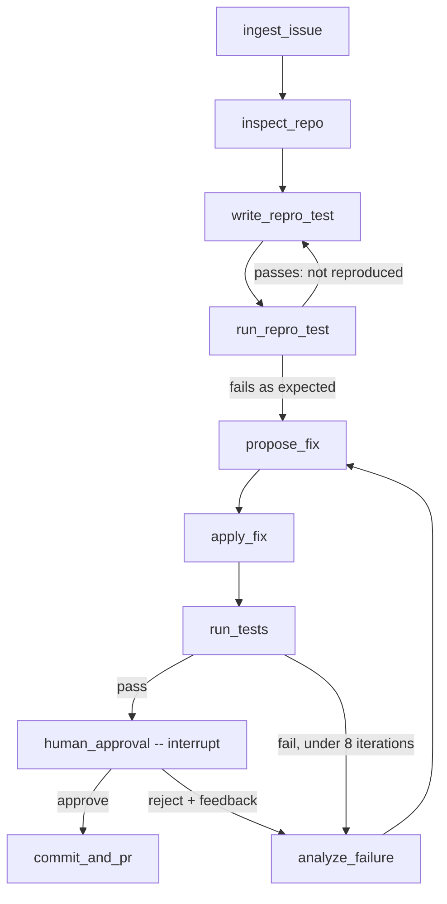

# Autonomous Bug-Fixing Agent

[](https://autonomous-bug-fixing-agent.streamlit.app)

**Live Demo:** [https://autonomous-bug-fixing-agent.streamlit.app](https://autonomous-bug-fixing-agent.streamlit.app)

An autonomous Python bug-fixing agent orchestrated with **LangGraph** and powered by **Groq**. It ingests a GitHub issue or bug report, inspects a repository, writes a failing `pytest` reproduction test, executes tests in an isolated sandbox, iterates on search/replace code fixes (up to 8 attempts), and **pauses for human-in-the-loop approval** before committing or exporting a patch.

## How It Works



The full architecture specification is in [SPEC.md](SPEC.md).

## Core Agent Pillars

| Pillar | Implementation |
|---|---|
| **LLM** | Groq (`openai/gpt-oss-120b`) with structured JSON outputs ([`src/agent/llm.py`](src/agent/llm.py)) |
| **Framework** | LangGraph state machine & conditional edge routers ([`src/agent/graph.py`](src/agent/graph.py)) |
| **Memory** | `AgentState` + `MemorySaver` / `PostgresSaver` checkpointing ([`src/agent/state.py`](src/agent/state.py)) |
| **Tools** | Path-jailed Workspace, Git/GitHub REST API & Sandbox test runners ([`src/tools/`](src/tools/), [`src/sandbox/`](src/sandbox/)) |

## Key Features

- **LangGraph Orchestration ([src/agent/graph.py](src/agent/graph.py), [src/agent/state.py](src/agent/state.py)):** Explicit `TypedDict` state with Pydantic v2 sub-models, pure conditional edge routers, and `MemorySaver` / `PostgresSaver` checkpointing.
- **Groq Free-Tier Guardrails ([src/agent/llm.py](src/agent/llm.py), [src/agent/prompts.py](src/agent/prompts.py)):**
  - `tenacity` exponential backoff for 429 rate-limit and transient API errors.
  - Hard cap of 8 fix iterations (`RunBudget`).
  - Active context pruning (`summarize_past_attempts`) and tail-truncated sandbox outputs to stay well under Groq's 8K tokens/min free tier.
  - Structured JSON output validation with automatic repair.
- **Pluggable Sandbox ([src/sandbox/](src/sandbox/)):**
  - `DockerSandbox` ([src/sandbox/docker_runner.py](src/sandbox/docker_runner.py)): Locked-down container (non-root user, `cap_drop=["ALL"]`, memory/CPU/PID limits, network disabled).
  - `LocalSandbox` ([src/sandbox/local_runner.py](src/sandbox/local_runner.py)): Subprocess fallback for environments without a Docker daemon (e.g., Streamlit Community Cloud), with environment secret scrubbing and process-tree timeout kills.
- **Path-Jailed Workspace ([src/tools/file_tools.py](src/tools/file_tools.py)):** Works on an isolated copy (`base/` + `work/`) so your target repository is never modified until approval. Supports built-in sample repos, local folders, or shallow-cloning any GitHub repository URL.
- **Single-URL Repository Audit & PDF Report ([src/ui/streamlit_app.py](src/ui/streamlit_app.py), [src/ui/report_pdf.py](src/ui/report_pdf.py)):** Paste a single GitHub repository URL to scan all files for bugs/defects, view a side-by-side Before/After diff and live telemetry bar, and download a printable PDF audit & fix report.
- **Human-in-the-Loop Gate ([src/agent/nodes.py](src/agent/nodes.py)):** `commit_and_pr` is reachable **only** after `human_approval` resumes from `langgraph.types.interrupt()`.

## Project Layout

```
src/
  agent/     state.py · llm.py · prompts.py · nodes.py · graph.py
  sandbox/   base.py · docker_runner.py · local_runner.py · factory.py · Dockerfile
  tools/     file_tools.py · git_tools.py
  ui/        streamlit_app.py · mock_graph.py · report_pdf.py
tests/
  unit/      test_state.py · test_docker_runner.py · test_routing.py · test_mock_graph.py · test_streamlit_app.py
  fixtures/  buggy_repo/
SPEC.md
requirements.txt
pyproject.toml
```

## Getting Started

```powershell
python -m venv .venv
.\.venv\Scripts\Activate.ps1          # Linux/macOS: source .venv/bin/activate
pip install -e ".[dev,ui]"
copy .env.example .env                # Set GROQ_API_KEY in .env
```

Optional — build the Docker sandbox image if running with Docker:

```bash
docker build -t bugfix-agent-sandbox:latest src/sandbox
```

## Running the Streamlit Web App

```bash
streamlit run src/ui/streamlit_app.py
```

In the sidebar you can:
1. Choose **Live Groq Agent** or **Scripted Demo (no API calls)**.
2. Select a repository source (**Built-in sample buggy repo**, **Local folder path**, or **GitHub URL (shallow clone)**).
3. Enter the bug title & description, then click **▶️ Start run**.
4. Review the generated reproduction test, unified diff, and pytest output when the agent pauses at `human_approval`, then click **Approve**, **Request changes**, or **Reject**.

### Deploying to Streamlit Community Cloud
1. Push this repository to GitHub.
2. In [share.streamlit.io](https://share.streamlit.io), create a new app pointing to `src/ui/streamlit_app.py`.
3. Under **App settings → Secrets**, add:
   ```toml
   GROQ_API_KEY = "gsk_..."
   SANDBOX_BACKEND = "local"
   ```

## Running the Tests

```bash
pytest
```

Tests marked `docker` execute real containers and are **skipped automatically** when no Docker daemon is reachable.

## Roadmap

- [x] **Phase 0:** Architecture specification (`SPEC.md`) & project scaffolding
- [x] **Phase 1:** `state.py` & `docker_runner.py` with unit tests
- [x] **Phase 2:** Path-jailed `file_tools.py`, `git_tools.py`, and `local_runner.py`
- [x] **Phase 3:** Groq client (`llm.py`), context pruner (`prompts.py`), LangGraph `nodes.py` & `graph.py`
- [x] **Phase 4 & 5:** End-to-end verification on `tests/fixtures/buggy_repo` & interactive Streamlit UI
