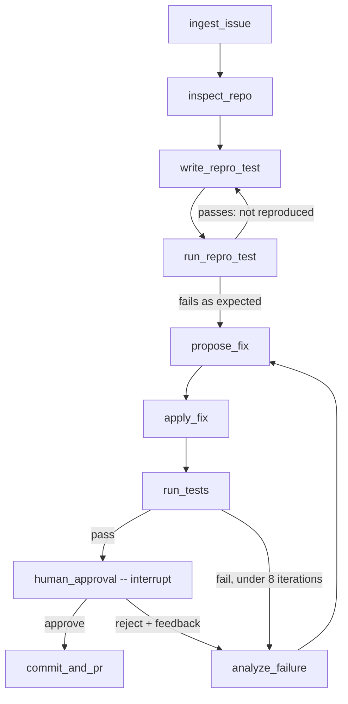

# Autonomous Bug-Fixing Agent

An agent that takes a GitHub issue or bug description, inspects a local repository, writes a reproduction test, runs it in an isolated Docker container, iterates on a fix until the test passes, and **pauses for human approval** before committing or opening a PR.

> **Status: early development.** The architecture is specified and the state schema and Docker sandbox runner are implemented. The LangGraph nodes, graph, LLM client and git tools are still stubs. See [Roadmap](#roadmap).

## How it works



The full design (state schema, node contracts, routing rules and sandbox interface) is in [SPEC.md](SPEC.md).

## Design highlights

- **Orchestration:** LangGraph with explicit state typing: a `TypedDict` for graph state and Pydantic v2 models for nested objects.
- **LLM:** Groq `llama-3.3-70b-versatile` via `langchain-groq`.
- **Free-tier guardrails:** `tenacity` exponential backoff on 429s, a hard cap of 8 fix iterations, and context pruning before every LLM call.
- **Sandbox:** one long-lived Docker container per run. It runs as a non-root user with all capabilities dropped, memory, CPU and PID limits, and the network disabled. Timeouts are enforced inside the container and output is tail-truncated.
- **Human-in-the-loop:** `commit_and_pr` is reachable only through the `human_approval` node, which uses LangGraph's `interrupt()`.
- **Checkpointing:** `MemorySaver` for development, with `PostgresSaver` planned.

## Project layout

```
src/
  agent/     state.py (done) · graph.py · nodes.py · prompts.py
  sandbox/   docker_runner.py (done) · Dockerfile
  tools/     file_tools.py · git_tools.py
  ui/        streamlit_app.py · mock_graph.py (scripted demo)
tests/
  unit/      test_state.py · test_docker_runner.py · test_mock_graph.py · test_streamlit_app.py · test_routing.py
  fixtures/  buggy_repo/
SPEC.md
```

## Getting started

Requirements: Python 3.11+ and Docker (a running daemon is needed for the sandbox tests).

```powershell
python -m venv .venv
.\.venv\Scripts\Activate.ps1          # Linux/macOS: source .venv/bin/activate
pip install -e ".[dev]"
copy .env.example .env                # then set GROQ_API_KEY
```

Build the sandbox image (the test suite also builds it automatically if missing):

```bash
docker build -t bugfix-agent-sandbox:latest src/sandbox
```

## Demo UI (scripted agent)

A Streamlit demo shows the workflow end to end: step-by-step progress, a failed first fix that is retried, and a real LangGraph `interrupt()` that pauses for Approve / Request changes / Reject. **The agent behind it is scripted** (no LLM, no Docker, nothing is committed), so it demonstrates the control flow and the human-approval gate, not real bug fixing.

```bash
pip install -e ".[ui]"
streamlit run src/ui/streamlit_app.py
```

## Running the tests

```bash
pytest
```

Tests marked `docker` execute real containers and are **skipped automatically** when no Docker daemon is reachable. All other tests run without Docker.

## Configuration

| Variable | Purpose |
|---|---|
| `GROQ_API_KEY` | Groq API key. Keep it in `.env`, which is gitignored; never commit it. |
| `GROQ_MODEL` | Defaults to `llama-3.3-70b-versatile`. |
| `CHECKPOINTER` | `memory` (default) or `postgres`. |
| `DATABASE_URL` | Postgres connection string when `CHECKPOINTER=postgres`. |

## Roadmap

- [x] **Phase 0:** SPEC and scaffold
- [x] **Phase 1:** `state.py` and `docker_runner.py` with unit tests (container tests pending a first run against a live Docker daemon)
- [ ] **Phase 2:** `file_tools.py` (path-jailed) and `git_tools.py`
- [ ] **Phase 3:** prompts, nodes, graph, Groq client with backoff and pruning, routing tests
- [ ] **Phase 4:** end-to-end run on `tests/fixtures/buggy_repo`, CLI, demo

