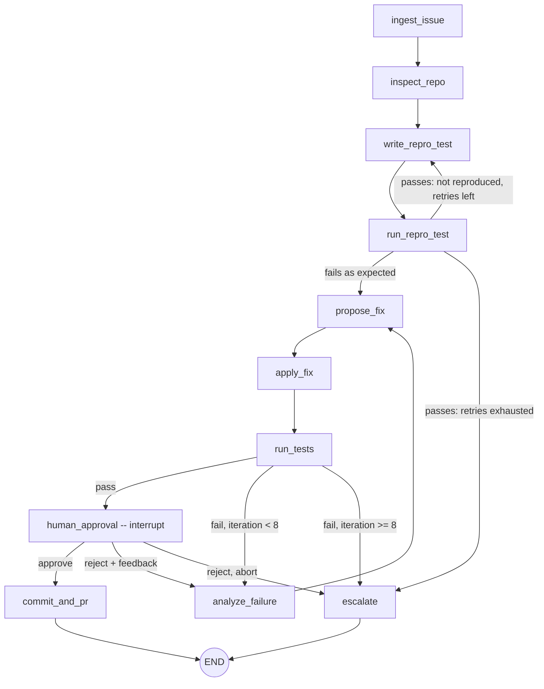

# Autonomous Bug-Fixing Agent — Architecture Spec

Status: **DRAFT v0.1 — for review.** No implementation exists yet; every file under `src/` is a stub.

## 1. Goal & Flow

Input: a GitHub issue / bug description + a local repo path.
Output: a reviewed, human-approved commit (and optionally a PR) containing a fix and a regression test.



Every LLM-calling node passes through the **context pruner** and the **Groq rate-limit wrapper** (section 6).

## 2. State Schema (`src/agent/state.py`)

The graph state is a `TypedDict` (LangGraph requirement for reducers). Structured sub-objects are **Pydantic v2** models, so they are validated at node boundaries and serialize cleanly through checkpointers (`model_dump(mode="json")`).

### 2.1 Pydantic models

| Model | Fields |
|---|---|
| `IssueInput` | `title: str`, `body: str`, `url: str \| None`, `number: int \| None`, `repo_path: Path` |
| `RepoContext` | `tree: str` (truncated listing), `relevant_files: dict[str, str]` (path → content snippet), `test_command: str`, `language: str` |
| `ReproTest` | `path: str`, `content: str`, `framework: Literal["pytest"]`, `confirmed_failing: bool` |
| `FilePatch` | `path: str`, `unified_diff: str` |
| `FixAttempt` | `iteration: int`, `rationale: str`, `patches: list[FilePatch]`, `result: SandboxResult \| None` |
| `SandboxResult` | `exit_code: int`, `stdout: str`, `stderr: str`, `timed_out: bool`, `duration_s: float`, `truncated: bool` (shared with the sandbox interface; defined in `docker_runner.py`, re-exported by `state.py`) |
| `ApprovalDecision` | `approved: bool`, `feedback: str \| None`, `reviewer: str \| None`, `decided_at: datetime` |
| `RunBudget` | `max_iterations: int = 8`, `max_repro_attempts: int = 2`, `max_context_tokens: int = 6000`, `max_tool_output_chars: int = 4000` |

### 2.2 `AgentStatus` (StrEnum)

`INGESTED`, `INSPECTED`, `REPRO_WRITTEN`, `REPRO_CONFIRMED`, `FIXING`, `TESTS_PASSING`, `AWAITING_APPROVAL`, `APPROVED`, `COMMITTED`, `ESCALATED`, `REJECTED`.

### 2.3 `AgentState` (TypedDict)

```python
class AgentState(TypedDict, total=False):
    issue: IssueInput
    repo: RepoContext
    repro_test: ReproTest
    attempts: Annotated[list[FixAttempt], operator.add]   # append-only history
    messages: Annotated[list[AnyMessage], add_messages]   # LLM conversation (pruned)
    iteration: int            # fix iterations consumed (0..max_iterations)
    repro_attempts: int       # repro-test generations consumed
    budget: RunBudget
    status: AgentStatus
    approval: ApprovalDecision | None
    branch: str | None
    commit_sha: str | None
    pr_url: str | None
    error: str | None         # terminal failure reason, set by escalate
```

Rules:
- Nodes return **partial updates only**; they never mutate the input state.
- `attempts` is full history for the audit trail. The LLM never sees it raw; the pruner builds a compact summary (section 6).
- `messages` is the only field the pruner rewrites.

## 3. Node Functions (`src/agent/nodes.py`)

All nodes: `(state: AgentState, config: RunnableConfig) -> dict` (partial update). Dependencies (LLM, sandbox, git tools) come from `config["configurable"]`, so tests can inject fakes.

| Node | Responsibility | Reads | Writes |
|---|---|---|---|
| `ingest_issue` | Validate/normalize the issue (parse a GitHub URL via API if given, else use the raw text); init budget and counters. | `issue` | `issue`, `budget`, `iteration=0`, `status` |
| `inspect_repo` | Build the repo tree, grep for symbols/stack traces named in the issue, read the top-N relevant files (size-capped), detect the test command. Uses `file_tools`. | `issue` | `repo`, `status` |
| `write_repro_test` | LLM writes a minimal failing pytest test; saved into the working tree. | `issue`, `repo`, `messages` | `repro_test`, `repro_attempts+1`, `messages` |
| `run_repro_test` | Run the repro test in the sandbox. We **expect failure**. A pass means the bug was not reproduced. | `repro_test` | `repro_test.confirmed_failing`, `status`, `messages` |
| `propose_fix` | LLM returns structured output (`FixProposal`: rationale + patches) via `with_structured_output`. | pruned context | `attempts` (+1, result=None), `messages` |
| `apply_fix` | Apply unified diffs in the working tree (`file_tools.apply_patch`); on patch failure, record the error and loop back without spending a sandbox run. | `attempts[-1]` | working tree, `attempts[-1]` error |
| `run_tests` | Run the repro test plus the existing suite in the sandbox; attach `SandboxResult` to the latest attempt; `iteration += 1`. | `repo.test_command` | `attempts[-1].result`, `iteration`, `status` |
| `analyze_failure` | LLM reads the (truncated) failing output + human feedback if any; produces diagnosis for the next `propose_fix`. | `attempts[-1]`, `approval` | `messages` |
| `human_approval` | Builds the review payload (diff, test result, rationale) and calls `langgraph.types.interrupt(payload)`. Resumed with `Command(resume=ApprovalDecision-dict)`. **The only path to `commit_and_pr`.** | `attempts`, `repro_test` | `approval`, `status` |
| `commit_and_pr` | `git_tools`: create branch `agent/fix-<issue#>`, stage, commit, optionally push + open PR via `gh`/API. Runs only on approved state. | `approval`, `issue` | `branch`, `commit_sha`, `pr_url`, `status=COMMITTED` |
| `escalate` | Terminal failure: write a report (what was tried, last output) and set `error`. Never commits. | all | `error`, `status=ESCALATED` |

## 4. Conditional Edge Routing (`src/agent/graph.py`)

Pure functions of state (no I/O), so they are trivially unit-testable.

```python
def route_after_repro(state) -> Literal["propose_fix", "write_repro_test", "escalate"]:
    if state["repro_test"].confirmed_failing:             return "propose_fix"
    if state["repro_attempts"] < state["budget"].max_repro_attempts: return "write_repro_test"
    return "escalate"

def route_after_apply(state) -> Literal["run_tests", "analyze_failure"]:
    return "analyze_failure" if state["attempts"][-1].patch_error else "run_tests"

def route_after_tests(state) -> Literal["human_approval", "analyze_failure", "escalate"]:
    if state["attempts"][-1].result.exit_code == 0:       return "human_approval"
    if state["iteration"] < state["budget"].max_iterations: return "analyze_failure"
    return "escalate"

def route_after_approval(state) -> Literal["commit_and_pr", "analyze_failure", "escalate"]:
    a = state["approval"]
    if a.approved:                                        return "commit_and_pr"
    if a.feedback and state["iteration"] < state["budget"].max_iterations:
        return "analyze_failure"                          # reviewer asked for changes
    return "escalate"
```

Invariants (each gets a test):
1. `iteration` never exceeds `max_iterations` (8). LangGraph `recursion_limit` is additionally set to a safe bound (about 4× nodes × iterations) as a hard backstop.
2. `commit_and_pr` has exactly one inbound edge: from `human_approval` via `route_after_approval`.
3. Timeouts and `SandboxResult.timed_out` count as failures, never as passes.

### Checkpointing & HITL
- `build_graph(checkpointer: BaseCheckpointSaver | None = None)` compiles with `MemorySaver()` by default.
- `get_checkpointer(settings)` factory: `MemorySaver` for dev; `PostgresSaver.from_conn_string(DATABASE_URL)` when `CHECKPOINTER=postgres` (extra dependency `postgres`; `.setup()` called once at startup).
- State must stay JSON-serializable for Postgres. This is why the models are Pydantic and `Path` is serialized as `str`.
- Runs are keyed by `thread_id`. A paused run is resumed with `graph.invoke(Command(resume=decision), config)`.

## 5. Docker Sandbox Interface (`src/sandbox/docker_runner.py`)

Library: `docker` (docker-py). The runner is a **long-lived container per agent run** (so installed state and edits persist across iterations). Commands run via `exec_run`.

```python
class SandboxConfig(BaseModel):
    image: str = "bugfix-agent-sandbox:latest"   # built from src/sandbox/Dockerfile
    workdir: str = "/workspace"
    mem_limit: str = "512m"
    nano_cpus: int = 1_000_000_000               # 1 CPU
    pids_limit: int = 256
    network_disabled: bool = True                # default-deny network
    default_timeout_s: int = 60
    max_output_bytes: int = 64_000               # stdout/stderr each, tail-preserved
    user: str = "sandbox"                        # non-root

class SandboxResult(BaseModel):
    exit_code: int; stdout: str; stderr: str
    timed_out: bool; duration_s: float; truncated: bool

class SandboxError(Exception): ...               # daemon unavailable, image missing, container died

class DockerSandbox:
    def __init__(self, config: SandboxConfig | None = None, client: DockerClient | None = None): ...
    def start(self, host_repo_path: Path) -> None   # create container, mount working copy
    def run(self, command: str, timeout_s: int | None = None) -> SandboxResult   # bash -lc
    def run_tests(self, test_command: str, timeout_s: int | None = None) -> SandboxResult
    def write_file(self, path: str, content: str) -> None
    def read_file(self, path: str) -> str
    def stop(self) -> None                         # idempotent; force-remove container
    def __enter__(self) / __exit__(...)            # guarantees cleanup
    @staticmethod
    def is_available() -> bool                     # daemon reachable
```

Design decisions:
- **Isolation:** non-root user, `cap_drop=["ALL"]`, `security_opt=["no-new-privileges"]`, memory, CPU and PID limits, network off by default. Dependencies are pre-baked into the image. If a repo needs installs, there is an explicit opt-in `network_disabled=False` setup phase.
- **Working copy, not the original repo:** the agent works on a `git worktree` or temp copy of the repo and bind-mounts it at `/workspace`. The user's checkout is untouched until approval.
- **Timeouts:** enforced inside the container with `timeout <n> bash -lc ...`. Exit code 124 maps to `timed_out=True`. This avoids orphaned processes, which a host-side timeout on `exec_run` would leave behind.
- **Output cap:** stdout/stderr are tail-truncated to `max_output_bytes` (failures appear at the end of pytest output). The state/prompt layer truncates again to about 4k chars for the LLM.
- **Cleanup:** the context manager and `stop()` always remove the container, including on exceptions.

## 6. Groq Free-Tier Guardrails

| Concern | Mechanism | Location |
|---|---|---|
| 429 / transient errors | `tenacity` `@retry(wait=wait_random_exponential(multiplier=2, max=60), stop=stop_after_attempt(6), retry=retry_if_exception_type(RateLimitError, APIConnectionError, ...))`. Honors the `retry-after` header when present. | `src/agent/llm.py` (added in a later phase) |
| Runaway loops | `max_iterations = 8` in `RunBudget` + routing invariants + LangGraph `recursion_limit`. | state, graph |
| Context growth | `prune_messages()` runs before every LLM call: (1) always keep system prompt, issue, and latest repro test; (2) replace old attempts with a one-line summary each (`iter 3: patched foo.py, test X failed: AssertionError`); (3) keep only the latest sandbox output, truncated to `max_tool_output_chars`; (4) final guard via `langchain_core.messages.trim_messages(max_tokens=max_context_tokens, strategy="last")`. | `src/agent/nodes.py` / helper |
| TPM bursts | Lightweight client-side pacing (min interval between calls) plus capped `max_tokens` on completions. | `llm.py` |
| Model | `ChatGroq(model="llama-3.3-70b-versatile", temperature=0)`, `GROQ_API_KEY` from env. | `llm.py` |

## 7. Project Layout

```
.
├── SPEC.md
├── pyproject.toml
├── .env.example
├── .gitignore
├── src/
│   ├── agent/
│   │   ├── state.py        # models + AgentState                (phase 1)
│   │   ├── graph.py        # build_graph, routers, checkpointer  (phase 3)
│   │   ├── nodes.py        # node functions + pruner              (phase 3)
│   │   └── prompts.py      # system / task prompts                (phase 3)
│   ├── sandbox/
│   │   ├── docker_runner.py   # DockerSandbox                     (phase 1)
│   │   └── Dockerfile         # python:3.12-slim + pytest, non-root user
│   └── tools/
│       ├── file_tools.py   # read/list/grep/apply_patch, path-jail  (phase 2)
│       └── git_tools.py    # branch/commit/push/PR                   (phase 2)
└── tests/
    ├── conftest.py              # `docker` marker, skip if daemon down
    ├── unit/
    │   ├── test_state.py            (phase 1)
    │   ├── test_docker_runner.py    (phase 1; integration-marked)
    │   └── test_routing.py          (phase 3)
    └── fixtures/
        └── buggy_repo/          # tiny repo with a known bug + expected repro test
```

## 8. Phases

1. **Phase 1:** `state.py`, `docker_runner.py`, Dockerfile, with unit tests that run real containers (marked `docker`, auto-skipped if there is no daemon).
2. **Phase 2:** `file_tools.py` (path-jailed to the repo root), `git_tools.py`.
3. **Phase 3:** `prompts.py`, `nodes.py`, `graph.py`, `llm.py`, routing tests with a fake LLM.
4. **Phase 4:** End-to-end run against `fixtures/buggy_repo`, CLI entry point, README.

## 9. Open Questions for Review

1. **Language scope:** Python/pytest only for v1? (This spec assumes yes.)
2. **PR creation:** `gh` CLI vs. PyGithub / REST. Spec leans `gh` for fewer dependencies, with push + PR optional (commit-only by default).
3. **Repo isolation:** `git worktree` (requires a git repo) vs. plain temp-dir copy. Spec leans worktree.
4. **Network in the sandbox:** off by default with pre-baked deps. OK, or do you want an install phase with network enabled?
5. **LLM client:** `langchain-groq` (`ChatGroq`) is assumed over a raw OpenAI-compatible client.

